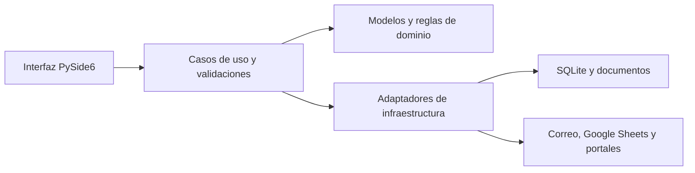

# GestorCompras · COMPRAS TN

### De un problema operativo de compras a una aplicación de automatización

**Diseñé y desarrollé una herramienta que conecta correos, documentos, Google Sheets y portales para ejecutar trabajo de compras por lotes y en segundo plano.** Automatiza la preparación de solicitudes de despacho, la organización de cotizaciones, la carga de órdenes y el seguimiento de tareas, con validaciones y revisión de resultados.

**Jimmy Toapanta · [eslay07](https://github.com/eslay07)**

Python · PySide6 · Selenium · Google Sheets · SQLite · SQLAlchemy

[Resultados y supuestos](docs/IMPACTO_OPERATIVO.md) · [Módulos y 25 capturas](docs/MODULOS.md) · [Instalador](https://github.com/eslay07/GestorCompras/releases/tag/v2.0.0) · [Guía técnica](docs/GUIA_TECNICA.md)

## El proyecto en una mirada

| Problema | Solución que construí | Impacto de referencia |
| --- | --- | --- |
| Repetir búsquedas, transcripción y recorridos por cada compra | Una aplicación que prepara lotes y coordina documentos, correo y portales | **11–15 h mensuales de ahorro operativo estimado** en el escenario documentado |
| Acompañar manualmente cada acción de una tarea | Flujos reutilizables y ejecución en segundo plano | **5 tareas reasignadas en ≈3 min**, frente a 10–15 min manuales |
| Copiar cada artículo de una orden entre sistemas | Lectura de Google Sheets, validación y carga automática | **1 OC de 5 ítems en ≈2 min**, frente a 4–5 min manuales |

Los tiempos por módulo son aproximaciones reportadas durante el uso del proyecto. La cifra mensual es una estimación con supuestos explícitos, no un cronometraje de horas netas de personal. [Consultar el cálculo completo](docs/IMPACTO_OPERATIVO.md).

**Estado:** Compras Bienes es el flujo operativo actual. Servicios conserva una interfaz preliminar y todavía no es funcional como flujo completo.


*Interfaz real con datos de demostración; las identidades y la información corporativa están ocultas. La galería no representa operaciones ejecutadas al generar las capturas.*

## Mi aporte al proyecto

Partí del recorrido de trabajo de compras: recibir información, localizar documentos, registrar órdenes y actualizar su seguimiento. Identifiqué las acciones repetidas y las convertí en módulos que comparten datos y controles.

| Capacidad | Implementación y evidencia |
| --- | --- |
| **Análisis y mejora de procesos** | Comparación por módulo del recorrido manual y automatizado, con volúmenes y tiempos de referencia. [Impacto operativo](docs/IMPACTO_OPERATIVO.md). |
| **Integración de sistemas** | Adaptadores para correo, documentos, Google Sheets y portales. [Infraestructura](COMPRAS%20TN%202.0/src/compras_tn/infrastructure/). |
| **Desarrollo de herramientas de escritorio** | Interfaz PySide6, selección de lotes, trabajos en segundo plano y resultados por elemento. [Presentación](COMPRAS%20TN%202.0/src/compras_tn/presentation/). |
| **Automatización con controles** | Validaciones previas, confirmaciones, control de duplicados y recuperación de pendientes. [Casos de uso](COMPRAS%20TN%202.0/src/compras_tn/application/). |
| **Entrega y mantenimiento** | Separación de responsabilidades, pruebas automáticas, evolución del esquema e instalador de Windows. [Pruebas](COMPRAS%20TN%202.0/tests/) · [Instalador](COMPRAS%20TN%202.0/tools/installer/). |

## Qué automatiza

| Módulo | Trabajo que resuelve |
| --- | --- |
| **Correos masivos** | Prepara solicitudes de despacho con plantilla, asunto y OC adjunta; envía a cada proveedor el mensaje correspondiente. |
| **Organizador de archivos** | Identifica cotizaciones por asunto, tarea, remitente o RUC y guarda los documentos en la carpeta correspondiente. |
| **Carga automática de OC** | Toma artículos, cantidades, precios y solicitantes de Google Sheets; registra la OC y los datos de autorización para seguimiento. |
| **Reasignación** | Detecta avisos de compras completas y prepara factura, ingreso, observaciones y destino para reasignar las tareas. |
| **Descargas OC** | Detecta órdenes aprobadas o acepta números manuales; descarga, identifica y organiza los archivos por tarea y proveedor. |
| **Orquestador** | Permite crear y reutilizar secuencias para observaciones, seguimientos y archivos en el portal de tareas. |

[Ver el funcionamiento, los tiempos y las capturas de cada módulo →](docs/MODULOS.md)

La reasignación se complementa con [Notificacion-automatica-tareas](https://github.com/eslay07/Notificacion-automatica-tareas), un proyecto del mismo autor en Google Apps Script que detecta entregas completas en Sheets y emite la notificación por correo.

## Decisiones técnicas



- **Separación de responsabilidades:** interfaz, casos de uso, dominio e infraestructura se mantienen en capas distintas.
- **Trabajo por lotes y en segundo plano:** la interfaz conserva la revisión y muestra los resultados de cada elemento.
- **Persistencia y recuperación:** se registran estados y pendientes para evitar reconstruir manualmente el trabajo o repetir acciones inciertas.
- **Entorno de ejecución aislado:** el instalador incorpora las dependencias compatibles, comprueba el arranque y respalda los datos antes de actualizar.

## Resultados, alcance y calidad

El escenario mensual documentado parte de **45 tareas** y estima **17–21 horas de recorrido manual frente a ≈6 h 15 min con el proyecto**. La finalidad es reducir esfuerzo por operación y permitir que el equipo atienda más trabajo con sus recursos disponibles.

La proyección de crecimiento y los criterios para evaluar necesidades de personal están en [Impacto operativo](docs/IMPACTO_OPERATIVO.md#más-volumen-con-menor-necesidad-de-trabajo-manual). Una reducción de dotación requiere medir la intervención humana neta y la carga completa de la función; el proyecto no la presenta como un resultado ya demostrado.

El repositorio incluye pruebas de servicios, validaciones, automatización mediante dobles de prueba, interfaz e instalador. Las integraciones reales requieren acceso autorizado y se mantienen fuera de la ejecución predeterminada. La instalación y el lanzamiento se comprobaron con Python 3.12; las dependencias para Python 3.13 se verificaron por resolución sin conexión.

No se publican bases operativas, credenciales ni perfiles reales de proveedores. [Privacidad](PRIVACY.md) · [Seguridad](SECURITY.md).

## Ejecutar o revisar el proyecto

**Windows de 64 bits · Python 3.12 o 3.13.** El [instalador completo](https://github.com/eslay07/GestorCompras/releases/tag/v2.0.0) está disponible en Releases. Para ejecutar desde el código, use una ruta corta para el entorno virtual:

```powershell
py -3.12 -m venv "$env:USERPROFILE\.venvs\compras-tn"
& "$env:USERPROFILE\.venvs\compras-tn\Scripts\python.exe" -m pip install -r requirements.txt
& "$env:USERPROFILE\.venvs\compras-tn\Scripts\python.exe" -m pip install -e ".\COMPRAS TN 2.0"
& "$env:USERPROFILE\.venvs\compras-tn\Scripts\python.exe" run.py
```

Para las operaciones reales, cada organización configura sus propios servicios y credenciales. Para revisar el proyecto sin ellas, consulte la [galería de demostración](docs/MODULOS.md) y las [instrucciones de pruebas](docs/GUIA_TECNICA.md#desarrollo-y-pruebas).

## Documentación

- [Impacto operativo: tabla mensual, supuestos y proyección de capacidad](docs/IMPACTO_OPERATIVO.md).
- [Módulos: explicación, tiempos y 25 capturas](docs/MODULOS.md).
- [Guía técnica: instalación, configuración, pruebas y estructura](docs/GUIA_TECNICA.md).
- [Manual del proyecto](COMPRAS%20TN%202.0/README.md) y [organización de documentos](COMPRAS%20TN%202.0/COTIZACIONES_Y_ADJUNTOS.md).

## Sobre el autor

**Jimmy Toapanta** · [Portafolio de GitHub](https://github.com/eslay07) · [LinkedIn](https://www.linkedin.com/in/jimmy-toapanta-950a441b8/)

Este proyecto reúne mi experiencia en el proceso operativo de compras y mi capacidad para convertirlo en una solución de software: analizar el recorrido, integrar herramientas, automatizar pasos y preparar una entrega instalable con controles y documentación.

## Licencia

Consulte [LICENSE.txt](LICENSE.txt).
